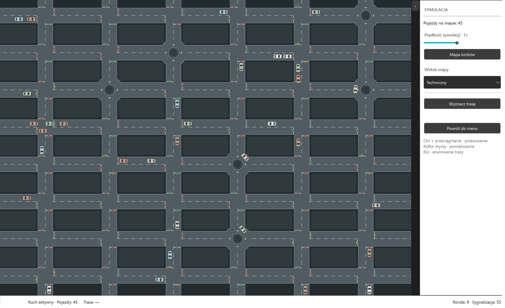
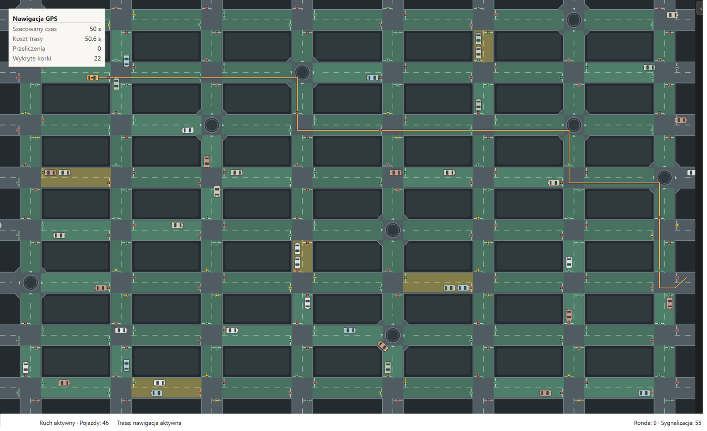
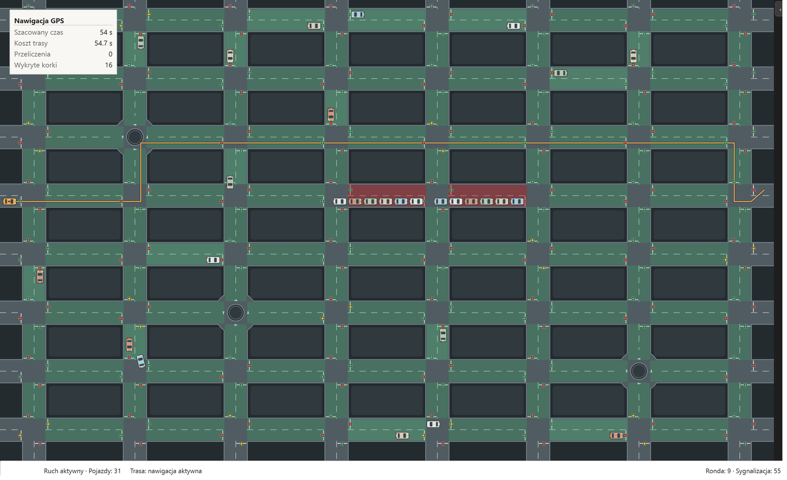
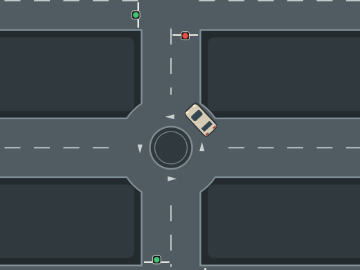
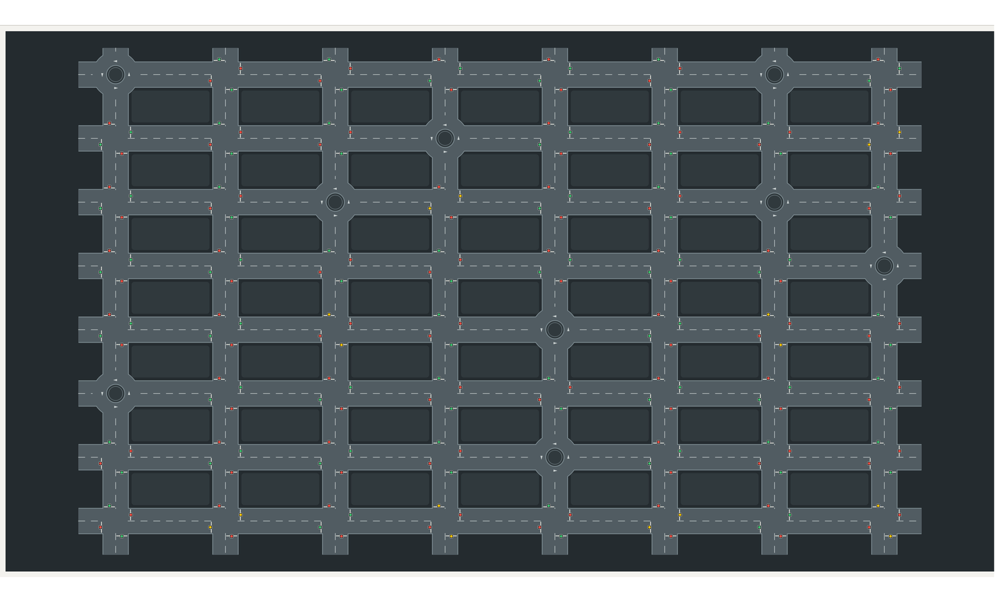

# EasyRider

  

EasyRider is a desktop traffic simulator built with C++ and Qt Widgets. Pick two checkpoints on the edge of a city grid and follow the highlighted **SmartCar** through live traffic. Its A* navigator weighs travel time, including queues and junction delays, while the car shares lanes, signals and roundabouts with the surrounding vehicles.



*Main window at normal speed. Short queues have formed at red lights while traffic continues through the roundabouts.*

[Build and run](#build-and-run) · [How routing works](#how-routing-works) · [Tests](#testing)

## Explore the simulation

- **Set up a city.** Choose a visual theme, preview or regenerate the roundabout layout on the fixed 8 × 8 grid, then select the initial vehicle count.
- **Follow a trip.** Select a start and destination at the map boundary. The highlighted route shows the planned turns. The navigation panel reports estimated time, route cost and replans.
- **Read the traffic.** Toggle the congestion heatmap to see which road segments are filling up. Zoom in to watch individual maneuvers or change the simulation speed from 0.25× to 4×.

## Inside a run



*The orange line traces the remaining trip. At the top left, the navigation panel shows a route cost of 50.6 seconds at the instant of capture.*



*In this scripted queue, 12 stopped cars raise the direct route estimate from 46.8 to 59.0 seconds. A* chooses the upper street at 54.7 seconds. The heatmap colors each block by the combined vehicle count in both directions.*

| Roundabout traffic | Map generation |
| --- | --- |
|  |  |
| A close-up from the main window catches a car turning along the ring. | The preview shows where roundabouts will replace signal-controlled junctions. |

## How routing works

The road network is a directed graph of intersections and boundary checkpoints. A search state records both the node and the incoming direction. Reaching a junction from the west leaves a different set of legal movements and turn costs than reaching it from the north.

A* minimizes **estimated seconds**. Each candidate move includes the maneuver through the junction, travel along the next segment and an allowance for delay. The traffic analyzer distinguishes stopped cars from moving traffic and accounts for speed. Nearby signal delays use phase information, more distant signals use an expected wait, and roundabout costs reflect occupancy. A longer drive can therefore beat the shortest-distance route when a direct approach is backed up.

The heuristic multiplies straight-line distance to the goal by a lower bound on seconds per unit distance derived from the graph edges. During a trip the navigator periodically prices an alternative and the remaining route from the same state using the same traffic snapshot. It replaces a valid route only when the saving reaches both **2.5 seconds and 10%** of the remaining cost. Small fluctuations can change the ETA without changing the next turn. [A* implementation](src/nav/DynamicPathfinder.cpp) · [Replanning logic](src/nav/RouteManager.cpp)

## Traffic simulation

**Signals and queues.** Cars brake for signals and for vehicles ahead on their predicted path. Before entering a junction they check for space on the far side. Left turns also require a gap in oncoming traffic. A Gipps-inspired safe-speed calculation uses the available gap, leader speed and braking limits. As the leader moves off, space opens for the next car to accelerate. Turning cars slow before following a circular arc between lane centers.

**Roundabouts.** An entering car yields to circulating traffic and checks for room beyond the merge point. Tangent Bézier curves connect its lane to the ring and the ring to its exit lane. If the exit is blocked, the car can continue around for another lap.

**Motion and collision checks.** The engine subdivides elapsed simulation time into steps of at most 1/60 second. Vehicles carry oriented rectangular footprints through turns. An independent test monitor checks overlaps, spacing and motion continuity, and records any emergency overlap correction. [Mechanics audit, in Polish](docs/MECHANICS_AUDIT.md)

## Architecture

| Source | Responsibility |
| --- | --- |
| [src/core](src/core) | Road geometry, vehicle motion, junction rules and the simulation update loop. |
| [src/nav](src/nav) | Traffic sampling, directed A* search, SmartCar route management and route geometry for drawing. |
| [src/gui](src/gui) and [ui](ui) | Qt Widgets, Designer forms, map camera, checkpoint picker and separate road, car and overlay renderers. |
| [tests](tests) | Interactive and headless runners using the application's core and navigation sources, plus scripted checks against the real main window. |

## Build and run

On Windows, use a Qt 6 desktop kit with **Core, Gui and Widgets**, its matching C++17 compiler, **CMake 3.16+** and Ninja. The commands below use the Qt 6.9.3 MinGW 64-bit kit with GCC 13.1. Qt Test enables the optional GUI check.

From the repository root in PowerShell, enter your Qt kit directory (the directory containing `bin\qmake.exe`). Put the matching MinGW, CMake and Ninja tools on PATH first, or run PowerShell in a shell configured for that kit.

```powershell
$qtKit = Read-Host 'Qt desktop kit directory'
$env:Path = "$(Join-Path $qtKit bin);$env:Path"
cmake -S . -B build/local -G Ninja -DCMAKE_BUILD_TYPE=Release "-DCMAKE_PREFIX_PATH=$qtKit"
cmake --build build/local --parallel
.\build\local\EasyRider.exe
```

In the Polish-language interface, choose a theme, accept the map and start traffic. Select **Wyznacz trasę** to pick the two endpoints. **Mapa korków** toggles the heatmap.

### Windows installer

With the Qt 6.9.3 MinGW x64 kit, GCC 13.1 and Inno Setup 6 installed on the build machine,
run the following after the Release build above. The packaging script uses the Qt kit and compiler
recorded by CMake. It downloads and verifies the matching Qt Base source archive for redistribution.

```powershell
.\packaging\windows\package.ps1 -BuildDir build/local
```

The installer and Qt source archive are written to `build/local/installer/`. Run the installer to
install EasyRider for the current user and launch it from the Start menu. The installed application
includes its Qt and MinGW runtime libraries. Remove it from the Apps page in Windows Settings.

## Testing

Run these commands from the same PowerShell session after building.

```powershell
.\build\local\EasyRiderTests.exe --headless 1
.\build\local\EasyRiderTests.exe --audit
.\build\local\EasyRiderGuiCheck.exe build/gui-check-local
```

A local Windows Release build passed **107/107 cases** in one headless run with Qt 6.9.3 and GCC 13.1. The headless suite covers geometry, spawning, flow, navigation and route rendering. The mechanics audit runs seeded scenarios, compares A* costs against an independent Dijkstra search and checks spacing, roundabout behavior and queues over time. Launch `EasyRiderTests.exe` without arguments for the interactive runner.

The optional `EasyRiderGuiCheck` opens the real application window, picks checkpoints through the interface and samples rendered motion against engine state. It writes captures and a report to the specified directory. In the session used for this gallery, all ten checkpoint trips reached their destination. The GUI check returned a failure after detecting 17 discontinuities in rendered vehicle positions. [GUI check source](tests/gui_check/gui_check.cpp)

## Project background

EasyRider is an academic project in computer science and mechatronics. It brings graph search and vehicle motion into the same experiment. A queue formed by individual braking decisions can change the route chosen across the city.
